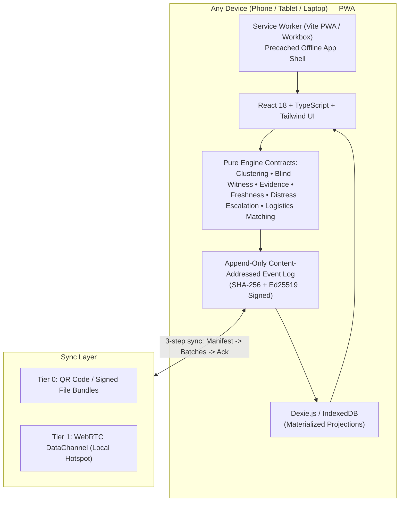

# CRISISCACHE v2.0
> **The offline-first evidence layer for disaster reporting and relief coordination.**  
> *"Tells witnesses from rumor and keeps working with zero infrastructure."*

---

## 🎯 What is CRISISCACHE v2.0?

In disaster zones where telecom and power infrastructure fail, two compounding problems occur:
1. **Unverified rumors multiply faster than facts**, overwhelming responders with phantom incidents because every forwarded message looks like a new confirmation.
2. **Locally available resources (water, medical supplies, shelter cots) sit unmatched** to nearby urgent needs because no connectivity exists to coordinate them.

**CRISISCACHE v2.0** provides a decentralized, append-only, content-addressed evidence ledger that operates on local devices with **zero external network dependencies** (no internet, no remote database, no CDN fonts or tile servers).

---

## ⚡ Key Innovations & Differentiators

| Feature | Mechanism & Implementation |
|---|---|
| **Blind Witness (Causal Independence Engine)** | Uses a causal `seenSet` snapshot captured when a user begins writing. If a device has already received reports in that cluster, independence is forced `false`. Prevents rumors and forwarded relays from inflating witness counts. |
| **Separate Distress Pipeline (Anti-Decay)** | Distress requests (`"I Need Help Now"`) are **structurally separated** from incident reports. They **never require corroboration** and **never decay or time out**. Instead, they feature an **automatic escalation ladder** (`STANDARD` → `URGENT` → `CRITICAL`) that raises urgency the longer they remain unacknowledged. |
| **Automatic Incident Clustering** | Groups reports deterministically using `(Category, Geofence Cell, Trailing TTL Window)`. Supports sticky Coordinator split/merge overrides. |
| **Merge Replay (Signature Interaction)** | Visualizes the exact belief evolution when two previously isolated network partitions sync. Shows what this device believed before vs after, and the specific events that triggered the change. |
| **Logistics-Aware Supply Matching** | Greedy multi-source resource allocator with unit conversions (gallons, liters, boxes, meals) and **automatic detection of active road blockages** along delivery routes. Detects concurrent double-approval conflicts. |
| **Honest Receipts with Delivery Reach** | Every submission immediately displays `"Saved on this device"` and a live delivery-reach progression (`"On this phone only"` → `"Reached N devices"` → `"Reached a coordinator"`). |
| **Tier 0 & Tier 1 Sync Protocols** | **Tier 0:** QR-code manifest exchange & downloadable/importable signed file bundles (`.json`).<br>**Tier 1:** Direct WebRTC DataChannel over local Wi-Fi or phone hotspot with QR-based signaling (no signaling server required). |
| **Cryptographic Provenance** | Every event is signed using Ed25519 (`@noble/ed25519`) with SHA-256 content addressing. State is a pure, deterministic projection over the event log. |

---

## 🏗️ Technical Architecture



---

## 🚀 Quick Start

### Prerequisites
- Node.js 18+ (tested on Node v24)
- npm 9+

### 1. Install Dependencies
```bash
npm install
```

### 2. Run Engine Unit & Regression Tests
```bash
npm test
```
*Executes all 18 unit tests validating clustering, Blind Witness causal independence, monotonic distress escalation, logistics matching, and distributed commutative convergence.*

### 3. Start Development Server
```bash
npm run dev
```
Open browser at `http://localhost:5173`.

### 4. Build for Production (Static PWA)
```bash
npm run build
npm run preview
```
*Generates zero-CDN production bundle in `dist/` with precached service worker for 100% offline usage.*

---

## 🎬 The 90-Second Rumor-vs-Witness Verification Script

To see the core thesis in action, click **"DEMO SCENARIOS"** in the top navigation bar and execute the steps:

1. **Reset to Base Disaster State**: Loads initial scenario with 1 road blockage on Market St and 1 water offer in South Basin.
2. **Elena Reports Flooding & Distress**: Elena submits a firsthand observation of rising water at 4th St underpass + an emergency distress call for 3 trapped people.
3. **Device D Relays Hearsay (The Rumor Test)**: Device D submits hearsay about the flood. The cluster **remains UNVERIFIED with 0 independent witnesses**, proving rumor repetition does not manufacture corroboration.
4. **Device E Corroborates (Blind Witness)**: Device E (an independent witness across town with an empty `seenSet`) submits a firsthand report. The cluster immediately elevates to **CORROBORATED (2 independent devices)**.
5. **Partition Merge & Contradiction**: Device F (scouting from another area) claims the underpass is clear. When the bridge opens, **Merge Replay triggers** and shows the belief diff as the incident becomes **CONTESTED**.
6. **Coordinator Resolves Conflict**: Commander Marcus Vance resolves the contradiction with a signed attributable reason (*"CERT pump drained underpass at 14:30"*), flipping the cluster to **RESOLVED**.
7. **Distress Escalation**: Inspect the distress queue to observe Elena's rescue request automatically escalate over time without decaying.

---

## 📄 License
MIT License. Built for disaster resilience and life-safety humanitarian relief.
